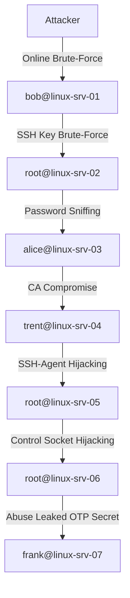

# Walk-Through

Here in this walk-through, you can find the solutions of the labs.

The attack path looks like this:



You can directly login on any system and start or continue the lab from
there by executing the `login`  script:

```shell-session
$ ./login
1) kali		 3) linux-srv-02  5) linux-srv-04  7) linux-srv-06
2) linux-srv-01	 4) linux-srv-03  6) linux-srv-05  8) linux-srv-07
Select system: 3
3) root
4) alice
Select user: 2

Logging into linux-srv-02 as alice ...
[...]

alice@linux-srv-02:~$ hostname
linux-srv-02.nullbyte.internal

alice@linux-srv-02:~$ whoami
alice
```